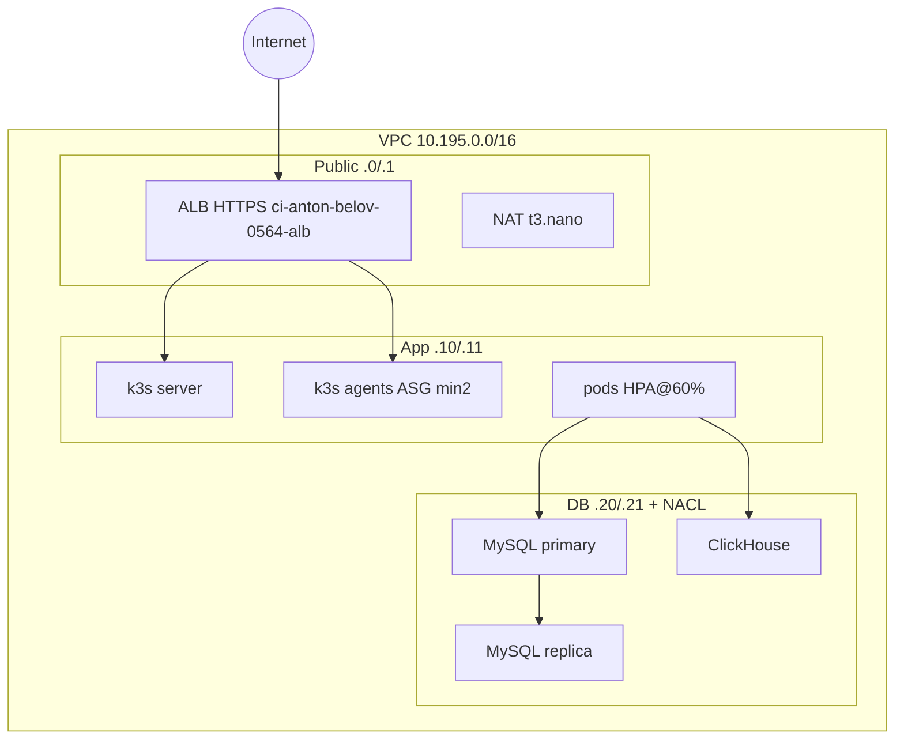

# CSS4005 Final Project Report

> **Primary submission format for evidence:** open **`REPORT.docx`** — each step has *action → screenshot box → explanation underneath*. Insert PNGs from `docs/evidence/`, then **Save As → PDF** (`REPORT.pdf`) for the course (official template asks for PDF; Word is the working file).
>
> Regenerate the Word file anytime: `py -3 scripts/build_report_docx.py`
>
> This Markdown stays as a text mirror / git-friendly copy. Replace `TODO:` / `FILL` after drills.

## 0. Cover

| Field | Value |
| --- | --- |
| Student | Anton Belov (0564) — **TODO: full student ID** |
| Course / stream | CSS4005 — **TODO: ENG-1 / ENG-2** |
| Track | AWS (own account) |
| Region / zones | `us-east-1`, zones `us-east-1a`, `us-east-1b` |
| Repository | **TODO: https://github.com/YOUR_USER/YOUR_REPO** |
| Demo video (if torn down) | **TODO** |
| Submission date | **TODO** |

## 1. Variant applied

| Field | My value | Where it is applied |
| --- | --- | --- |
| theme | Library books | `APP_NAME` in `deploy/k8s/configmap.yaml`; items = library books |
| resource_prefix | `ci-anton-belov-0564` | Every Name tag; S3/ECR/ALB/ASG; `Project` default tag in `terraform/providers.tf` |
| vpc_cidr | `10.195.0.0/16` | `terraform/modules/network` + `terraform.tfvars` |
| traffic_pattern | spiky | ASG target tracking + k6 spike stages in `scripts/loadtest.js` |
| rpo | 15 min | `mysqldump` cron every 15 min (`scripts/mysql-primary.sh`) + hourly EBS DLM |
| rto | 30 min | Restore + failover drill procedures in §7 (measure after deploy) |
| monthly_budget_usd | 15 | `terraform/modules/budget` AWS Budget alerts at 80%/100% |
| db_engine | mysql | Self-hosted MySQL 8 primary + replica |
| clickhouse_required | yes | ClickHouse VM + `CLICKHOUSE_URL` secret at deploy |
| cluster | k3s-on-autoscaled-vms | `terraform/modules/compute` server + agent ASG |
| hpa_cpu_target | 60 | `deploy/k8s/hpa.yaml` `averageUtilization: 60` |
| password_min_length | 14 | MySQL `validate_password`, ConfigMap, CI password test |
| password_require_symbol | yes | MySQL special_char_count=1; `check_password` requires symbol; CI test |
| alert_cpu_pct | 80 | CloudWatch alarm `ci-anton-belov-0564-cpu-high` |
| alert_5xx_per_min | 20 | CloudWatch alarm `ci-anton-belov-0564-5xx-high` |
| backup_retention_days | 30 | S3 lifecycle + DLM retain 30 days |

## 2. Architecture

### 2.1 Diagram

See Mermaid source: [`docs/diagrams/architecture.mmd`](docs/diagrams/architecture.mmd).



**TODO:** paste exported PNG of the live console topology after apply.

### 2.2 Shared responsibility

| Area | AWS | Me |
| --- | --- | --- |
| Physical DC, hypervisor, managed ALB/S3/IAM/Secrets | AWS | — |
| VPC design, SG/NACL chaining, NAT instance | — | me |
| OS hardening, unattended-upgrades, non-root services | — | me |
| MySQL install, replication, backups, failover | — | me (self-hosted moves this off RDS) |
| k3s control plane + agents, Traefik, app Deployment/HPA | — | me |
| Image build/scan/deploy, monitoring alarms, budget | — | me |

### 2.3 ADRs (≥ 4)

1. [ADR-001 Single NAT instance](docs/adr/001-single-nat-instance.md)
2. [ADR-002 MySQL async GTID](docs/adr/002-mysql-async-gtid-replication.md)
3. [ADR-003 k3s autoscaled](docs/adr/003-k3s-on-autoscaled-vms.md)
4. [ADR-004 Self-signed TLS on ALB](docs/adr/004-tls-self-signed-acm.md)

## 3. Networking

### Subnet plan

| Tier | Zone | CIDR | Route |
| --- | --- | --- | --- |
| public | us-east-1a | 10.195.0.0/24 | IGW |
| public | us-east-1b | 10.195.1.0/24 | IGW |
| app | us-east-1a | 10.195.10.0/24 | NAT instance ENI |
| app | us-east-1b | 10.195.11.0/24 | NAT instance ENI |
| db | us-east-1a | 10.195.20.0/24 | NAT instance ENI |
| db | us-east-1b | 10.195.21.0/24 | NAT instance ENI |

### Security groups

| SG | Inbound | Source | Why |
| --- | --- | --- | --- |
| sg-alb | 80/443 | 0.0.0.0/0 | Only public entry |
| sg-k3s | 30080/30443 | sg-alb | App from LB only |
| sg-k3s | all | self | Cluster fabric |
| sg-db | 3306,8123,9000 | sg-k3s | DB from app only |
| sg-db | 3306 | self | Replication |
| sg-nat | all | VPC CIDR | Private egress |

**Second layer:** NACL on DB subnets allows MySQL/ClickHouse only from app CIDRs (+ ephemeral return).

**Evidence TODO:**
- `aws ec2 describe-security-groups --filters Name=tag:Project,Values=ci-anton-belov-0564`
- From a public/bastion host: `nc -vz <mysql-primary-ip> 3306` → timeout
- Screenshot of NACL rules

## 4. Compute, Linux and Kubernetes

- Launch templates / user-data: `scripts/k3s-server.sh`, `scripts/k3s-agent.sh`, `scripts/mysql-*.sh`, `scripts/clickhouse.sh`
- Hardening: non-root app UID 10001; MySQL/ClickHouse package users; IMDSv2 required; SSM Session Manager (no public SSH by default); unattended-upgrades
- Cluster: k3s server + ASG agents; zone label `topology.kubernetes.io/zone` from IMDS

**Evidence TODO:**
```bash
kubectl get nodes -L topology.kubernetes.io/zone
kubectl get pods -n campus-app -o wide
kubectl get hpa -n campus-app
kubectl rollout history deploy/campus-app -n campus-app
ss -tulpn   # on node/DB via SSM
systemctl status k3s mysql clickhouse-server
```

**Node/zone drill TODO:** `kubectl cordon/drain` one agent or stop instance → pods reschedule → ALB still 200 on `/readyz`.

## 5. Load balancing and auto scaling

- ALB in both public subnets; HTTPS listener (ACM imported self-signed); HTTP→HTTPS redirect
- Health check: HTTP `/readyz` on NodePort 30080
- Pod scaling: HPA 60% CPU, min 2
- Node scaling: ASG target tracking (~60% CPU) for **spiky** traffic
- Load test: `k6 run -e BASE_URL=https://$ALB scripts/loadtest.js`
- Self-healing: delete pod + terminate agent → replacements

**Evidence TODO:** CloudWatch graphs during k6; browser warning note for self-signed cert.

## 6. Storage

- Bucket `ci-anton-belov-0564-files`: versioning, BPA, AES256, lifecycle (noncurrent expire 30d, IA transition, backups/ expire 30d)
- Attachments via S3 + short-lived presigned URLs (app storage layer)
- DB data on separate encrypted EBS (`/dev/xvdf`), DLM hourly snapshots, retain 30 days

**Evidence TODO:** bucket console screenshots; `aws s3api get-bucket-lifecycle-configuration`; snapshot list; presigned URL expiry demo.

## 7. Self-hosted database

- MySQL 8 primary (db-a) + replica (db-b), GTID async replication
- ClickHouse in db tier; app `CLICKHOUSE_URL` set at deploy
- Roles: `admin` / `app_rw` / `app_ro` (+ `repl`); show denied actions for limited roles
- Password policy: length ≥14, MEDIUM (upper/lower/digit/symbol); weak password rejected in MySQL and `POST /api/admin/check-password`
- Backups: 15-min mysqldump → S3 (`backups/mysql/`); hourly EBS snapshots
- Restore test TODO: restore dump to fresh DB, verify rows, time ≤ 30 min RTO
- Failover drill TODO: stop primary, `STOP REPLICA; RESET REPLICA ALL; SET GLOBAL read_only=0` on replica (or `STOP REPLICA; SET GLOBAL super_read_only=OFF`), redeploy app DB host, measure downtime vs RTO 30 min and data loss vs RPO 15 min

### Self-hosted vs RDS

| Topic | Self-hosted (this project) | RDS |
| --- | --- | --- |
| Backups | You schedule dump + snapshots | Automated backups/PITR |
| Patching | unattended-upgrades + you | AWS |
| Failover | Manual/scripted promote | Multi-AZ automatic |
| Monitoring | You ship metrics/logs | Enhanced Monitoring |
| Cost | Small EC2 + ops time | Instance + storage premium |
| Effort | High | Low |

**Conclusion:** lab/learning and tight budgets → self-hosted; production customer data with strict RTO → RDS Multi-AZ (or Aurora).

## 8. Identity and secrets

- Node role: read own secrets, S3 bucket, ECR pull, CW logs; DB role: secrets + `backups/*` put; SSM core on both
- Secrets Manager: `db-admin`, `db-app-rw`, `db-app-ro`, `db-repl`, `clickhouse`, `app-secret-key`, `k3s-token`
- Boot scripts fetch secrets via instance profile; K8s Secret created at deploy from Secrets Manager (not in git)
- Terraform `random_password` in state → remote S3 backend + DynamoDB lock (`backend.tf.example`); outputs avoid raw passwords
- Rotation plan: create new `app_rw` password in Secrets Manager → update MySQL user → rollout pods with new secret → drop old hash (zero-downtime dual-password window)

Ideal node policy JSON: see Terraform `module.iam` (`aws_iam_role_policy.node`).

## 9. Containers and CI/CD

- Multi-stage non-root `Dockerfile`
- CI (`.github/workflows/ci.yml`): lint → test → password policy → gitleaks → terraform fmt/validate → Trivy config → build → Trivy image → push immutable git-SHA tag to ECR → `scripts/deploy-app.sh` → rollout status
- Auth: GitHub OIDC → `ci-anton-belov-0564-role-gha` (set `github_org_repo` + secret `AWS_ROLE_ARN`)
- Rollback: `kubectl -n campus-app rollout undo deployment/campus-app` or redeploy previous SHA

**Evidence TODO:** green CI run; failed run blocked by gitleaks/Trivy; rollout history.

## 10. Security checks — findings table

| Check | Tool | Finding | Severity | Status |
| --- | --- | --- | --- | --- |
| Secret scan | gitleaks | **TODO after first CI** | — | fixed / accepted |
| Image scan | Trivy | **TODO** | CRITICAL fail gate | |
| IaC scan | Trivy config | **TODO** | HIGH/CRITICAL fail | |
| Password policy | DB + app + CI | length 14 + symbol | — | enforced |
| Network review | manual | only ALB 80/443 from 0.0.0.0/0 | — | accepted design |
| Storage review | manual | BPA + encryption | — | ok |
| IAM review | manual | least-privilege roles | — | ok |
| TLS | manual | self-signed ACM | low UX | accepted (ADR-004) |

## 11. Infrastructure as Code

```
terraform/
  main.tf providers.tf variables.tf outputs.tf
  modules/{network,storage,secrets,iam,database,compute,loadbalancer,monitoring,budget}
scripts/   # cloud-init + deploy + loadtest
deploy/k8s/
```

- State: S3 + DynamoDB lock (see `terraform/backend.tf.example`)
- CI: `terraform fmt -check`, `terraform validate`
- Reproducibility TODO: time `terraform destroy` then `terraform apply` rebuild

Variant knobs live in `terraform/terraform.tfvars` (gitignored; example committed).

## 12. Monitoring and logging

- Dashboard `ci-anton-belov-0564-main`: ALB req/5xx/latency, ASG CPU, MySQL status, log snippet
- Alerts (≥4): CPU >80%, 5xx >20/min, unhealthy hosts, MySQL status check → SNS email
- Logs: `/ci-anton-belov-0564/app` and `/db` (Fluent Bit / CW agent — enable on nodes during bring-up)
- Saved query TODO: filter app JSON logs by `request_id`

**Evidence TODO:** alarm firing → OK; dashboard screenshots.

## 13. High availability, Well-Architected and cost

- Zone-failure drill TODO: drain/stop all nodes in one AZ → pods on other AZ → record user impact
- Well-Architected:
  - **Operational excellence:** IaC, CI, ADRs, SSM
  - **Security:** SG chaining, NACL, secrets manager, scans, non-root
  - **Reliability:** 2 AZ, replica, HPA/ASG, drills vs RPO/RTO
  - **Performance:** spiky target tracking, HPA 60%
  - **Cost:** NAT instance, small instances, budget $15, destroy after evidence
  - **Sustainability:** rightsizing, scale-to-min, teardown
- Cost: Pricing Calculator estimate **TODO**; actual spend **TODO**; budget alert at $15; optimizations: (1) NAT instance not GW, (2) t3.micro replica, (3) destroy after demo, (4) S3 IA lifecycle
- Teardown proof TODO: `terraform destroy` + empty resource screenshot

## 14. Reflection

**Hardest problem:** fitting ALB + NAT + multi-VM MySQL/ClickHouse/k3s under a **$15** cap — solved with NAT instance ADR and short-lived evidence window.

**Next:** HA k3s servers, Prometheus in-cluster scrape of `/metrics`, automated failover DNS/SSM parameter swap.

**Sources:** course PDF/rubric/template; HashiCorp AWS provider docs; k3s docs; MySQL GTID docs; AI assistant (Cursor) used to scaffold Terraform/modules/report — all designs reviewed and will be explained at defense file-by-file.
